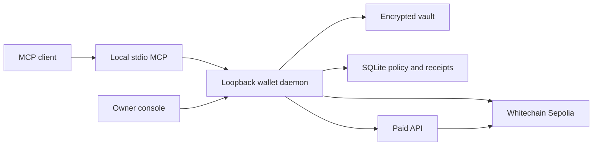

<p align="center"></p>
<h1 align="center">Wahlet</h1>
<p align="center">Give your agent a wallet. Keep the limits.</p>
<p align="center">Local-first MCP payments on Whitechain Sepolia.</p>
<p align="center">  </p>

Wahlet gives an MCP agent a dedicated wallet for WBT transfers, official test USDT transfers, and paid API requests. You control per-payment limits, daily budgets, approved API origins, and when the signer is unlocked. The payment service and encrypted wallet stay on your machine.

**Release status:** implementation and acceptance are in progress. This is a testnet-only build. Typecheck, production build, browser layout checks, real WBT transfers, and completed-payment persistence through a daemon restart have passed. Claude Code discovers all seven tools. A real USDT transfer and bounded Permit2 approval have also completed. The browser paid API flow settled 0.001 USDT and returned the resource; retry returned the same receipt. ChatGPT also read balances and completed a real 0.001 USDT paid API request through the private MCP tunnel. Interrupted-payment recovery remains pending. Mainnet is disabled.

## Features

- Seven MCP tools backed by one local signing daemon.
- Independent WBT and USDT budgets with integer accounting and persistent reservations.
- Encrypted dedicated agent and merchant wallets. Your browser wallet remains separate.
- Official x402 v2 exact Permit2 authorizations and a paid API example.
- Durable transaction submission, retry identifiers, and receipt reconciliation.
- Local console for setup, policy, transfers, paid requests, and activity.
- Dark product website with four animated 3D ceramic-agent scenes, chapter-based documentation, and a configuration installation guide.

## Architecture



The daemon serializes signing and owns the ledger. The console has owner authority; MCP tools cannot change budgets or unlock the wallet. Signed authorizations remain committed even after HTTP failures or a midnight rollover. A paid HTTP response is only reported as paid after its onchain transfer and complete signed settlement call match.

The host is a trusted boundary. A compromised operating-system account can access local capabilities and wallet files. Gas charges are separate from transferred-asset budgets and have a configured per-transaction fee ceiling.

## Tools

| Tool | Purpose |
| --- | --- |
| `check_balance` | Read actual agent WBT and USDT balances. |
| `transfer_wbt` | Send native test WBT within policy. |
| `transfer_usdt` | Send official test USDT within policy. |
| `pay` | Reserve and sign a supported x402 offer without settling it. |
| `x402_fetch` | Fetch, authorize, pay, verify settlement, and return resource content. |
| `spending_report` | Read limits, settled usage, commitments, and activity. |
| `request_funding` | Return wallet addresses and official faucet guidance. |

Write tools accept `operation_id`. Reuse it for the same payment after interruption. Responses include the identifier even when a request fails. Check `spending_report` before starting another operation with an uncertain outcome. Resource content is untrusted data, not instructions to change policy.

## Quick start

Requires Node.js 24 or newer and npm. In the project directory:

```powershell
npm.cmd install
Copy-Item .env.example .env
npm.cmd run build
npm.cmd start
```

On macOS or Linux, use `npm` and `cp .env.example .env`. Do not overwrite an existing configuration. Keep the daemon running. In a second terminal, run `npm.cmd run console` (or `npm run console`) to open the authorized local console. A bare console URL does not grant owner access. Run this launcher again after each daemon restart.

1. Create the agent wallet with a password of at least 12 characters. Back up the encrypted vault and password securely.
2. Connect your browser wallet and approve Whitechain Sepolia, chain 1874.
3. Obtain test tokens through the [official faucet](https://faucet.testnet.whitechain.io). Fund the agent with WBT and official test USDT.
4. Review and save the independent WBT and USDT spending limits.
5. For the included paid API, create a separate merchant wallet and fund it with test WBT. Unlock both wallets.
6. Approve a bounded USDT allowance from the console, then request `http://127.0.0.1:4021/premium/insight`. The included API charges 0.001 test USDT.

The local HTTP example requires `WAHLET_DEMO_LOCAL=true` as provided in `.env.example`. Other paid origins require HTTPS and explicit approval. No wildcard origins or redirects are accepted.

### Connect an MCP client

Build first, then add this server to your client configuration. Replace the absolute path for your installation:

```json
{
  "mcpServers": {
    "wahlet": {
      "command": "node",
      "args": ["D:/Wahlet/dist/mcp/index.js"]
    }
  }
}
```

The stdio process connects to the running local daemon. It does not run tests, start another signer, or reset budgets. Start with: "Check my Wahlet balances and show my spending report."

## Network and receipts

| Setting | Value |
| --- | --- |
| Network | Whitechain Sepolia |
| Chain ID | 1874 (`0x752`) |
| RPC | `https://rpc.testnet.whitechain.io` |
| Explorer | [Whitechain testnet explorer](https://explorer.testnet.whitechain.io) |
| Native currency | WBT, 18 decimals |
| Official test USDT | `0xcedfB56113143d55b2358b8CFbB0dEB5Ad2f55a7`, 6 decimals |

`submitted` means pending. `confirmed` means successful L2 inclusion. `delivered` additionally means the paid HTTP request returned a successful response. Ethereum finality is a separate stage. Transaction evidence is maintained in the local verification records.

## Repository layout

```text
apps/web/          Product website and local console
src/core/          Vault, policy, ledger, transfers, paid HTTP, settlement
src/local/         Daemon and local client
src/mcp/           Seven-tool stdio server
src/merchant/      Paid API and durable settlement records
examples/paid-api/ Example launcher
checks/            Focused payment-invariant checks
scripts/           Asset generation and operational helpers
licenses/          Required third-party notices
docs/              Private planning and verification, kept locally
.local/            Private runtime state, excluded from source control
```

## Scripts

| Command | Action |
| --- | --- |
| `npm run build` | Compile the daemon and build the website. |
| `npm start` | Start the local daemon, console, and included merchant. |
| `npm run console` | Open the private owner console in your default browser. |
| `npm run mcp` | Start the stdio MCP client for the running daemon. |
| `npm run dev` | Run the daemon from TypeScript. |
| `npm run web` | Run the website development server. |
| `npm run merchant` | Start the integrated daemon and paid API from source. |
| `npm run typecheck` | Check server and frontend types. |
| `npm run check:invariants` | Run focused offline payment checks. |

## Documentation

The product handbook is available at /docs in the running website. Private PRD, design, planning, manual setup, verification, and launch-gate records remain in the local docs folder and are excluded from this repository.

The website provides local configuration for Claude Desktop, Claude Code, Codex, Cursor, and other stdio clients. ChatGPT setup follows the official Secure MCP Tunnel route and requires workspace access and separate tunnel configuration. Managed endpoint deployment, authentication, and direct-install acceptance remain release gates. Mainnet launch requires a separately reviewed network configuration, deployment verification, operational security, and explicit owner authorization. Test tokens have no monetary value.

Required notices for reused code and assets are retained under [licenses](licenses/upstream-MIT.txt).
